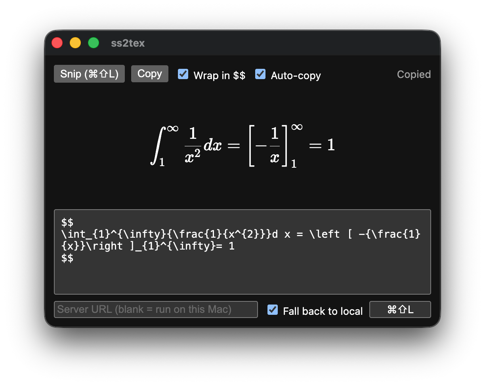

# ss2tex - Screenshot to LaTeX



Snip an equation from a PDF or slide and get LaTeX on your clipboard.

I created this because when I'm in a lecture and have the slides up on my laptop, sometimes it is impossible to copy equations, and sometimes even if it is possible they come out looking strange. I fully vibecoded this utility to help with that. It's not perfect but it gets the job done. 

OCR runs offline with [Texo](https://github.com/alephpi/Texo), either on your Mac or on a (Mac) server you run yourself. The output is shown next to a KaTeX preview so you can check it.

The app only runs on Apple Silicon Macs. Snipping uses macOS's built-in `screencapture`, and the ONNX runtime only ships an arm64 binary for macOS.

## Usage

Press **⌘⇧L** from anywhere, drag a box around the equation, and paste. To change the shortcut, click the shortcut field and press a new combo.

- **Wrap in \$$** puts the output in a `$$ … $$` block. Toggling it also rewraps the current result.
- **Auto-copy** copies each result to the clipboard. It's on by default.
- The app works while minimised or hidden (⌘H) as long as auto-copy is on. The window only comes back if a snip fails or auto-copy is off.
- The output box is editable, and the preview updates as you type.

## Install

```sh
npm install
npm run dist
```

This builds `dist/ss2tex-mac-arm64.zip` with the model bundled, so the app works offline from first launch. Unzip it into `/Applications`. The build is only ad-hoc signed, so clear the quarantine flag before opening it:

```sh
xattr -dr com.apple.quarantine /Applications/ss2tex.app
```

On first launch, ss2tex asks for Screen Recording access. Turn it on in System Settings, then press Restart in the prompt.

To run from source instead, use `npm start`. The model (~80 MB) downloads on first launch.

> The reason for why there is no releases page on this repository is because personally I wouldn't trust an app that asks for screen permissions, especially if the author is unverified. I won't be paying for the Apple Developer License, so I won't build it for you.

## Server

On slower machines, like my laptop, you can run the OCR on another box. Copy `compose.example.yml` to `compose.yml`, change it if needed, then:

```sh
docker compose up -d --build
```

Paste the server's address (e.g. `http://192.168.1.10:8000`) into the server field in the app. Leave the field blank to run on the Mac. Tick **Fall back to local** to use the Mac's own model when the server can't be reached.

The server has no auth, so keep it on a network you trust (LAN, VPN, or behind a reverse proxy).

Without Docker, run `node src/server.js`. Set `PORT` to change the port from the default, 8000.

The API is a single endpoint:

```sh
curl --data-binary @equation.png http://localhost:8000/ocr
```

## Tests

```sh
npm test
```

## License

[AGPL-3.0](LICENSE). The image preprocessing is ported from [Texo-web](https://github.com/alephpi/Texo-web), and the [Texo](https://github.com/alephpi/Texo) model weights ship inside the built app and the Docker image. Both are AGPL-3.0 too.
